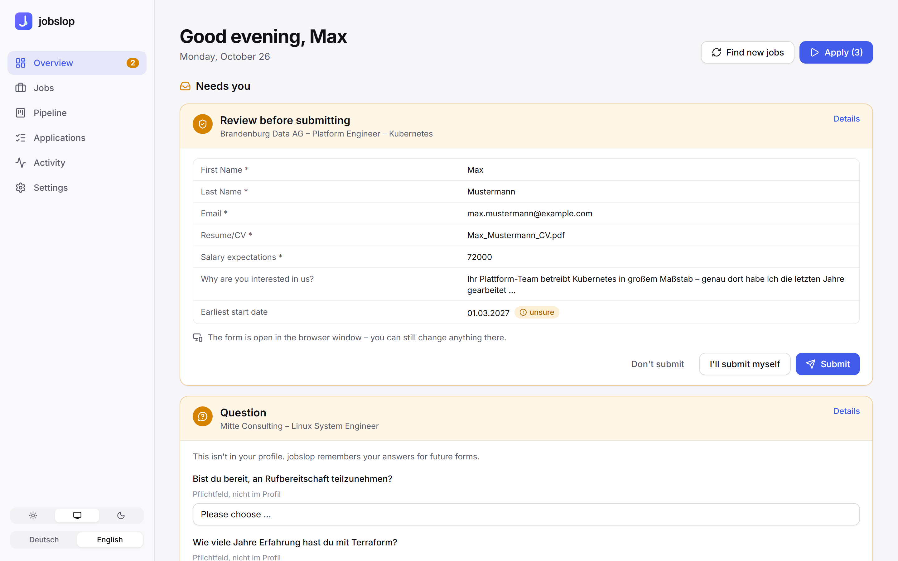
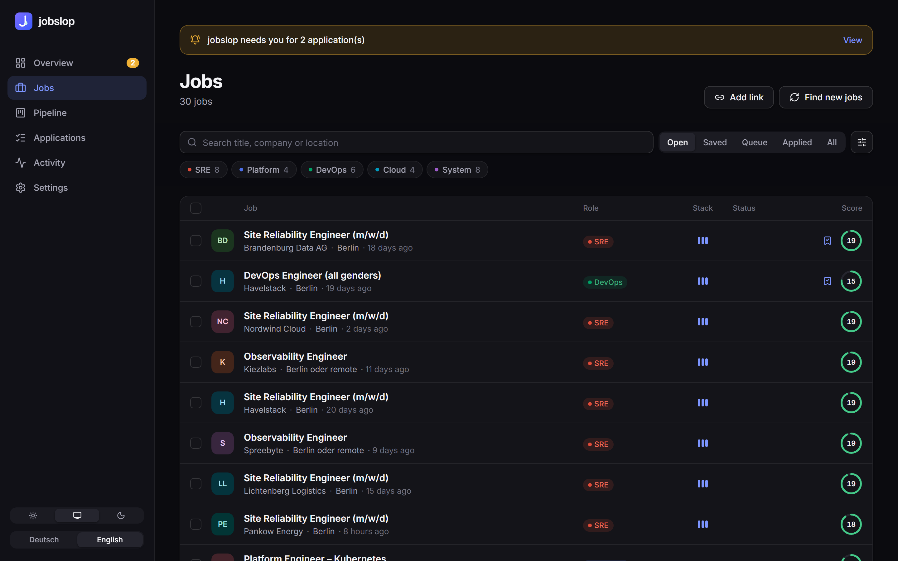
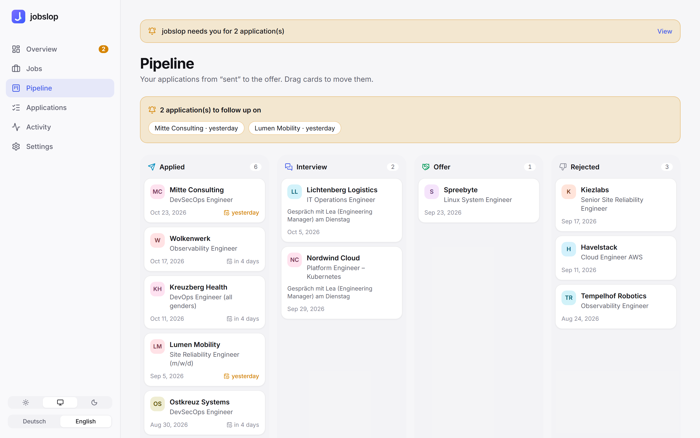
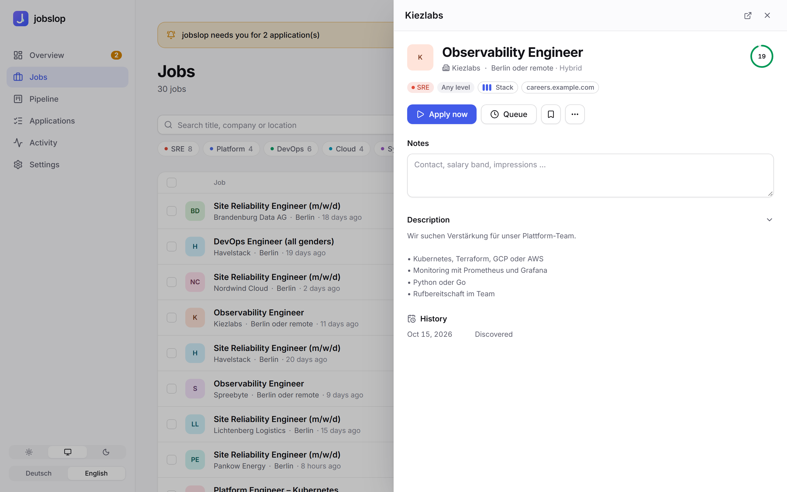
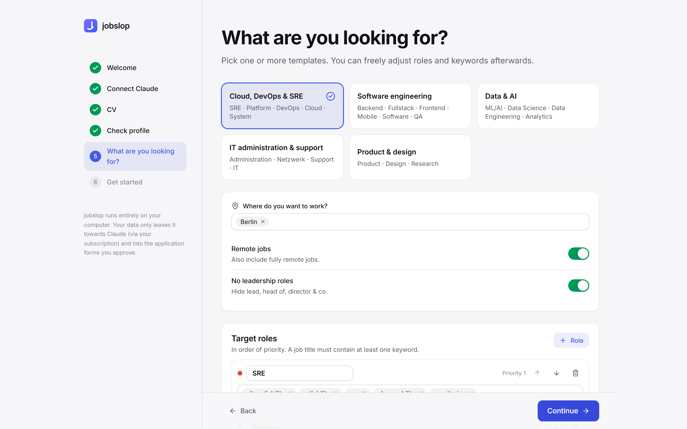

<div align="center">


# jobslop

**A local, AI‑driven job application autopilot – slopped together, but surprisingly careful.**

jobslop finds jobs, ranks them against your profile and fills out application forms in a real browser.
It thinks with **your own Claude subscription** (via Claude Code), runs **entirely on your computer**
and asks before it submits anything.

[](https://github.com/1xxn/jobslop/actions/workflows/ci.yml)


[Deutsch](README.de.md) · [Quickstart](#quickstart) · [How it works](#how-it-works) · [FAQ](#faq) · [Docs](docs/)

<picture>
  <source media="(prefers-color-scheme: dark)" srcset="docs/screenshots/overview-dark.png">
  
</picture>

</div>

## Why

Applying for jobs is 10 % deciding and 90 % copy‑pasting the same answers into slightly different forms.
jobslop does the copy‑pasting. You keep the deciding.

- **Finds jobs** on job boards (Arbeitnow, Himalayas), company boards (Greenhouse, Ashby, Lever,
  SmartRecruiters, Personio, Workday, amazon.jobs) and any careers page – de‑duplicated, with history.
- **Ranks them honestly.** Claude reads the requirements and tells you what fits, what doesn't and what
  to watch out for (on‑call, German C2, “senior” in disguise …).
- **Applies in a real browser.** It handles iframes, shadow DOM, custom dropdowns, multi‑step wizards,
  cookie banners, “autofill from résumé” buttons and file uploads – on practically any form layout.
- **Never makes things up.** It only uses facts from your profile, CV and answer bank. Anything missing
  becomes a question for you, and your answer is remembered for next time.
- **Tracks everything.** Kanban pipeline from *applied* to *offer*, follow‑up reminders, notes,
  screenshots of every step, statistics.

## Features

| | |
|---|---|
| 🧭 **Guided setup** | One command, then a setup wizard in the browser: connect Claude, drop your CV (it fills your profile), pick what you're looking for. |
| 🎯 **Target roles for any field** | Templates for Cloud/DevOps/SRE, software, data & AI, IT admin and product/design – or define your own roles and keywords. |
| 🤝 **Three modes** | *With approval* (review every submission), *automatic* (submits when everything is certain), *dry run* (fill only). |
| 🤖 **Autopilot** | Searches on a schedule, queues the best matches and applies – in the dashboard or via Task Scheduler/cron. |
| 🔔 **Notifications** | Browser notifications, plus push to your phone via [ntfy](https://ntfy.sh) or any webhook (Discord, Slack, Home Assistant). |
| 🗂️ **Pipeline** | Drag‑and‑drop board, notes, follow‑up dates, response and interview rates. |
| 🔗 **Add any job by link** | Paste a URL – jobslop reads title, company and location (schema.org JobPosting first, Claude only if needed). |
| 🛡️ **Guard rails** | Company limits, exclusions, duplicate detection, no double submissions, LinkedIn/Indeed are never automated. |
| 🌗 **Polished UI** | Light & dark mode, German & English, keyboard friendly, responsive down to phone size. |

<table>
  <tr>
    <td></td>
    <td></td>
  </tr>
  <tr>
    <td></td>
    <td></td>
  </tr>
</table>

## Quickstart

You need a **Claude Pro or Max subscription**. jobslop uses it through [Claude Code](https://claude.com/claude-code) –
there are no API keys and no API costs.

**Windows (PowerShell)**

```powershell
irm https://raw.githubusercontent.com/1xxn/jobslop/main/install.ps1 | iex
```

**macOS / Linux**

```bash
curl -fsSL https://raw.githubusercontent.com/1xxn/jobslop/main/install.sh | sh
```

The installer sets up [uv](https://docs.astral.sh/uv/), offers to install Claude Code, installs jobslop and its
browser and starts it. From then on, just run:

```bash
jobslop
```

Your browser opens the dashboard at `http://127.0.0.1:8765`. On first start the setup wizard walks you through
everything – no config files to edit.

<details>
<summary>Manual installation / from source</summary>

```bash
git clone https://github.com/1xxn/jobslop.git
cd jobslop
uv sync
uv run jobslop install-browser
uv run jobslop
```

Requirements: Python 3.12+ (uv installs it for you), [Claude Code](https://claude.com/claude-code) signed in with
your Claude account (`claude`, then `/login`).

</details>

## How it works

```
 Sources                      Local database              Your dashboard
┌──────────────────────┐     ┌──────────────────┐        ┌──────────────────────────┐
│ Arbeitnow, Himalayas  │     │ jobs + history    │        │ overview · jobs · pipeline│
│ Greenhouse, Ashby,    │──▶ │ applications      │ ◀────▶ │ questions & approvals     │
│ Lever, SmartRecruiters│     │ answer bank       │        │ settings · autopilot      │
│ Personio, Workday, …  │     └──────────────────┘        └──────────────────────────┘
└──────────────────────┘              │                               ▲
                                      ▼                               │ asks you
                        ┌───────────────────────────────────┐         │
                        │ Apply engine (separate process)    │─────────┘
                        │ Playwright browser ─ read the form │
                        │ Claude Code ─ plan every field     │
                        │ executor ─ fill, verify, submit    │
                        └───────────────────────────────────┘
```

1. **Crawl** – public job‑board APIs and careers pages are queried, filtered by your roles, locations and
   exclusions, de‑duplicated and stored with a change history (`new`, `updated`, `closed`, `reopened`).
2. **Rank** – a rule score (role priority, stack fit, company, level, location) plus a Claude assessment of
   the actual requirements.
3. **Apply** – jobslop opens the posting in its own Chromium profile, closes cookie banners, uses autofill
   buttons, reads every field (including iframes and shadow DOM) and lets Claude plan the values. The executor
   fills each field type correctly, verifies it, moves through multi‑step forms and – depending on the mode –
   asks you before submitting. Every step is saved with screenshots.

More detail: [docs/architecture.md](docs/architecture.md).

## Usage

Everything is in the dashboard. The CLI is there for power users and automation:

| Command | What it does |
|---|---|
| `jobslop` | Start the dashboard (setup wizard on first run) |
| `jobslop doctor` | Check Claude login, browser, profile and database |
| `jobslop crawl` | Search all sources now |
| `jobslop queue add --top 10` | Queue the best 10 matches |
| `jobslop apply --queue --mode review` | Apply in the terminal instead of the dashboard |
| `jobslop autopilot` | One unattended autopilot run (for Task Scheduler/cron) |
| `jobslop import jobs.json` | Import your own job list |
| `jobslop login <url>` | Sign in to an application portal once (e.g. `https://my.greenhouse.io`) |

Configuration reference: [docs/configuration.md](docs/configuration.md).

## Privacy & responsibility

- **Local first.** Database, profile, CV, screenshots – everything lives in `~/.jobslop` on your machine.
  The dashboard only listens on `127.0.0.1` and rejects requests from other sites.
- **Your data leaves your computer** only towards Claude (through your own subscription) and into the forms
  of the applications you start.
- **You are responsible for what is sent in your name.** Start with *dry run* or *with approval*. Respect the
  terms of the sites you use. jobslop deliberately does not automate LinkedIn or Indeed, solves no CAPTCHAs
  and hands logins over to you.

## FAQ

<details>
<summary><b>Why not Docker?</b></summary>

jobslop drives a *visible* browser so you can step in for CAPTCHAs, logins and final checks, and it uses your
local Claude Code login. Inside a container both need extra plumbing (VNC, mounted credentials) for no real
gain – the native install is one command and keeps everything in one folder.
</details>

<details>
<summary><b>How much of my Claude quota does it use?</b></summary>

Filling one application usually takes 2–6 Claude calls (Sonnet). Ranking uses Haiku with six jobs per call and
is capped at 60 jobs per search. If you hit your limit, jobslop pauses cleanly – nothing half‑filled is
submitted – and continues after the reset.
</details>

<details>
<summary><b>Does it work outside of tech / outside Germany?</b></summary>

Roles, keywords, locations and sources are fully configurable, and the setup wizard has templates for several
fields. The bundled sources focus on Germany/Europe; any careers page can be added in the settings.
</details>

<details>
<summary><b>Can it apply via LinkedIn “Easy Apply”?</b></summary>

No, on purpose – LinkedIn and Indeed detect automation and ban accounts. For such links jobslop opens the page,
you click through to the employer's site, and jobslop takes over there.
</details>

<details>
<summary><b>Why the name?</b></summary>

Because it is, admittedly, an AI‑slopped automation bot – just one that double‑checks its slop before it hits
“submit”.
</details>

## Development

```bash
uv sync                      # Python deps
uv run pytest -m "not live"  # tests (real Chromium against local test forms)
uv run ruff check . && uv run ruff format --check .

cd frontend && npm ci && npm run dev     # dashboard with hot reload (proxies to :8765)
npm run build                            # builds into src/jobslop/web/dist (committed)
```

Demo data for UI work: `uv run python scripts/demo_data.py --home .demo-home`, then
`JOBSLOP_HOME=.demo-home uv run jobslop`. See [CONTRIBUTING.md](CONTRIBUTING.md).

## License

[MIT](LICENSE) – use it, fork it, slop it.
